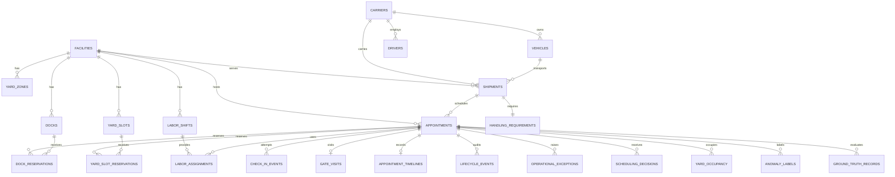
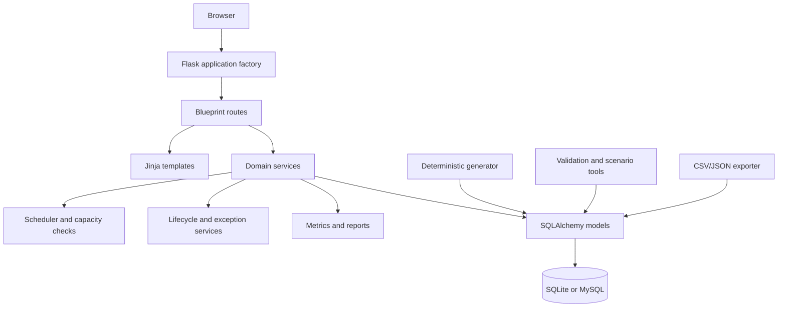
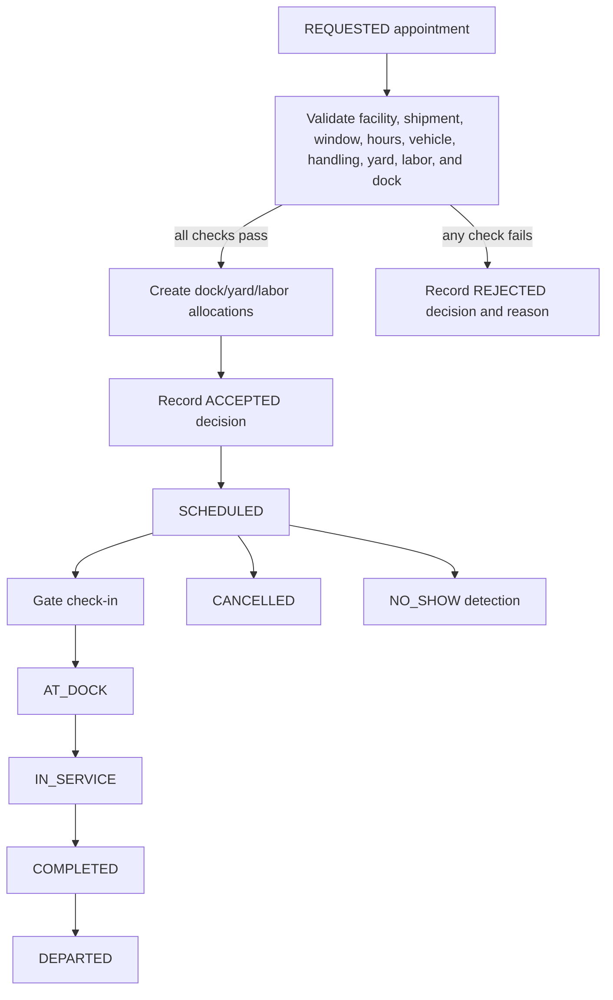
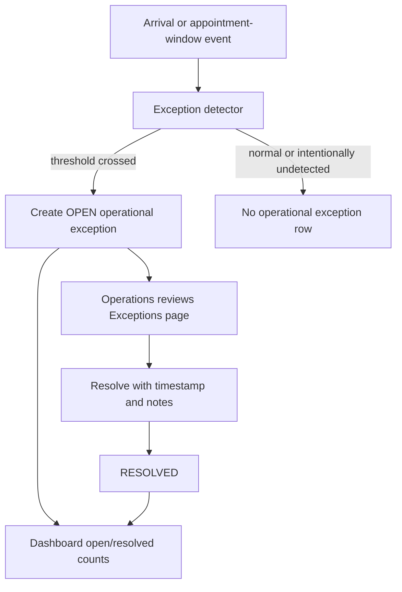

# DockFlow diagrams

These diagrams describe the current Flask application and SQLAlchemy models.
They are documentation only; they do not change the schema or runtime logic.

## Database ER diagram

`SimulationRun` is a standalone seed/mode/idempotency record. `GroundTruthRecord`
and `AnomalyLabel` are evaluation artifacts; they are not scheduling inputs.

## System architecture

## Appointment scheduling workflow

## Exception handling workflow

